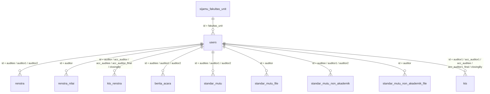

# Daftar Relasi Tabel `users` (Berdasarkan Kode Lama `architecture`)

Dokumen ini merangkum seluruh relasi tabel dan kolom yang berhubungan dengan tabel **`users`** berdasarkan hasil analisis pada direktori `/Applications/XAMPP/xamppfiles/htdocs/unpak_jamintu_lpmi/architecture` (mencakup `Domain/Entity`, `Infrastructure/Repository`, `Core/Service`, dan `Application/Controller`).

---

## 1. Ringkasan Cepat (Tabel & Kolom)

### A. Relasi Keluar dari Tabel `users` (Outgoing Foreign Key)
| Tabel Asal | Kolom Asal | Tabel Tujuan | Kolom Tujuan | Keterangan |
| :--- | :--- | :--- | :--- | :--- |
| `users` | `fakultas_unit` | `sijamu_fakultas_unit` | `id` | Menghubungkan user (level `auditee` / `fakultas`) ke unit/prodi/fakultas terkait |

### B. Relasi Masuk ke Tabel `users` (`users.id`) dari Tabel Lain (Incoming Foreign Keys)
| No | Nama Tabel | Nama Kolom | Referensi ke `users` | Peran / Konteks Data |
| :---: | :--- | :--- | :--- | :--- |
| 1 | `renstra` | `auditee` | `users.id` | User Auditee pada penugasan audit Renstra |
| 2 | `renstra` | `auditor1` | `users.id` | User Auditor 1 (Utama) pada penugasan audit Renstra |
| 3 | `renstra` | `auditor2` | `users.id` | User Auditor 2 (Tambahan) pada penugasan audit Renstra |
| 4 | `renstra_nilai` | `auditor` | `users.id` | User Auditor penilai pada detail nilai indikator Renstra |
| 5 | `kts_renstra` | `auditor` | `users.id` | User Auditor pembuat temuan KTS Renstra / Dokumen Tambahan |
| 6 | `kts_renstra` | `acc_auditor` | `users.id` | User Auditor yang menyetujui/submit form KTS Renstra (Step 1) |
| 7 | `kts_renstra` | `acc_auditee` | `users.id` | User Auditee yang memverifikasi (terima/tolak) KTS Renstra (Step 2) |
| 8 | `kts_renstra` | `acc_auditor_final` | `users.id` | User Auditor pada tahap penyelesaian akhir KTS Renstra (Step 4) |
| 9 | `kts_renstra` | `closingBy` | `users.id` | User yang menutup (closing / `tutup_kts`) KTS Renstra (Step 5) |
| 10 | `berita_acara` | `auditee` | `users.id` | User Auditee pada Berita Acara & Berita Acara V2 |
| 11 | `berita_acara` | `auditor1` | `users.id` | User Auditor 1 pada Berita Acara & Berita Acara V2 |
| 12 | `berita_acara` | `auditor2` | `users.id` | User Auditor 2 pada Berita Acara & Berita Acara V2 |
| 13 | `standar_mutu` | `auditee` | `users.id` | User Auditee pada Evaluasi Diri (Standar Mutu Akademik) |
| 14 | `standar_mutu` | `auditor1` | `users.id` | User Auditor 1 pada Evaluasi Diri (Standar Mutu Akademik) |
| 15 | `standar_mutu` | `auditor2` | `users.id` | User Auditor 2 pada Evaluasi Diri (Standar Mutu Akademik) |
| 16 | `standar_mutu_file` | `auditor` | `users.id` | User Auditor yang memverifikasi berkas Standar Mutu Akademik |
| 17 | `standar_mutu_non_akademik` | `auditee` | `users.id` | User Auditee pada Evaluasi Non-Akademik |
| 18 | `standar_mutu_non_akademik` | `auditor1` | `users.id` | User Auditor 1 pada Evaluasi Non-Akademik |
| 19 | `standar_mutu_non_akademik` | `auditor2` | `users.id` | User Auditor 2 pada Evaluasi Non-Akademik |
| 20 | `standar_mutu_non_akademik_file` | `auditor` | `users.id` | User Auditor yang memverifikasi berkas Standar Mutu Non-Akademik |
| 21 | `kts` | `auditor1` | `users.id` | User Auditor 1 pada laporan KTS (Akademik & Non-Akademik) |
| 22 | `kts` | `acc_auditor1` | `users.id` | User Auditor 1 yang meng-ACC form KTS awal |
| 23 | `kts` | `acc_auditee` | `users.id` | User Auditee yang meng-ACC tindakan perbaikan KTS |
| 24 | `kts` | `acc_auditor1_final` | `users.id` | User Auditor 1 yang melakukan final ACC pada KTS |
| 25 | `kts` | `closingBy` | `users.id` | User yang menutup (closing) laporan KTS |

### C. Relasi pada View Database yang Mereferensikan `users.id`
| No | Nama View | Nama Kolom | Referensi ke `users` | Keterangan |
| :---: | :--- | :--- | :--- | :--- |
| 1 | `view_evaluasi_renstra` | `auditee` | `users.id` | Diturunkan dari `renstra.auditee` |
| 2 | `view_evaluasi_renstra` | `auditor1` | `users.id` | Diturunkan dari `renstra.auditor1` |
| 3 | `view_evaluasi_renstra` | `auditor2` | `users.id` | Diturunkan dari `renstra.auditor2` |

---

## 2. Diagram Relasi (ERD) Tabel `users`

---

## 3. Detail Referensi File pada `architecture`

### 1. `users` (`Architecture\Domain\Entity\User`)
- **File Entity:** `Domain/Entity/User.php`
  - `FakultasUnit()`: `hasOne(FakultasUnit::class, 'id', 'fakultas_unit')`
- **File Repository:** `Infrastructure/Repository/PenggunaImpl.php`
  - Eager loading `with(['FakultasUnit', 'FakultasUnit.fakultas', 'FakultasUnit.prodi'])`.
  - Menyimpan `fakultas_unit` hanya jika `level` adalah `auditee` atau `fakultas`.

### 2. `renstra` (`Architecture\Domain\Entity\Renstra`)
- **File Entity:** `Domain/Entity/Renstra.php`
  - `Auditee()`: `hasOne(User::class, 'id', 'auditee')`
  - `Auditor1()`: `hasOne(User::class, 'id', 'auditor1')`
  - `Auditor2()`: `hasOne(User::class, 'id', 'auditor2')`
- **File Entity Lain (Join Query):** `Domain/Entity/NilaiRenstra.php` (method `scopeRecord`)
  - `leftJoin('users as auditee_user', 'auditee_user.id', '=', 'renstra.auditee')`
  - `leftJoin('users as auditor1_user', 'auditor1_user.id', '=', 'renstra.auditor1')`
  - `leftJoin('users as auditor2_user', 'auditor2_user.id', '=', 'renstra.auditor2')`
- **File Controller:**
  - `Application/Controller/RenstraController.php` (menyimpan & memperbarui `auditee`, `auditor1`, `auditor2`, serta mengambil email dari `User::whereIn('id', $userIdNotify)`).
  - `Application/Controller/EvaluasiRenstraController.php` (mengecek otorisasi `in_array(Session::get("id"), [$renstra->auditee, $renstra->auditor1, $renstra->auditor2])`).

### 3. `renstra_nilai` (`Architecture\Domain\Entity\NilaiRenstra`)
- **File Entity:** `Domain/Entity/NilaiRenstra.php`
  - `Auditor()`: `hasOne(User::class, 'id', 'auditor')`

### 4. `kts_renstra` (`Architecture\Domain\Entity\KtsRenstra`)
- **File Entity:** `Domain/Entity/KtsRenstra.php`
- **File Controller:** `Application/Controller/EvaluasiRenstraController.php`
  - Baris 331 & 367 (`kts()`): mengisi `"auditor" => Session::get('id')` saat generate KTS dari `view_evaluasi_nilai_renstra` maupun `view_evaluasi_dokumen_tambahan`.
  - Baris 464 (`update_kts()` step `1`): `$kts->acc_auditor = Session::get('id')`.
  - Baris 470 (`update_kts()` step `2`): `$kts->acc_auditee = Session::get('id')`.
  - Baris 487 (`update_kts()` step `4`): `$kts->acc_auditor_final = $kts->acc_auditor`.
  - Baris 493 (`update_kts()` step `5`): `$kts->closingBy = Session::get('id')`.
  - Baris 654 (`dokumen_kts()`): `User::whereIn('id', array_values(array_unique([$data->auditor, $data->acc_auditor, $data->acc_auditee, $data->acc_auditor_final, $data->closingBy])))->get()`.

### 5. `berita_acara` (`Architecture\Domain\Entity\BeritaAcara`)
- **File Entity:** `Domain/Entity/BeritaAcara.php`
  - `auditeex()`: `hasOne(User::class, 'id', 'auditee')`
  - `auditor1x()`: `hasOne(User::class, 'id', 'auditor1')`
  - `auditor2x()`: `hasOne(User::class, 'id', 'auditor2')`
- **File Controller & Service:**
  - `Application/Controller/BeritaAcaraV2Controller.php` (menyimpan & mengambil relasi `auditeex`, `auditor1x`, `auditor2x` untuk PDF).
  - `Application/Controller/DatatableBeritaAcaraV2Controller.php` (filter `auditee`, `auditor1`, `auditor2` berdasarkan `$id_user`).
  - `Core/Service/BeritaAcaraUC.php` & `Infrastructure/Repository/BeritaAcaraImpl.php`.

### 6. `standar_mutu` (`Architecture\Domain\Entity\StandarMutu`)
- **File Entity:** `Domain/Entity/StandarMutu.php`
  - `auditeex()`: `hasOne(User::class, 'id', 'auditee')`
  - `auditor1x()`: `hasOne(User::class, 'id', 'auditor1')`
  - `auditor2x()`: `hasOne(User::class, 'id', 'auditor2')`
- **File Repository & Service:**
  - `Infrastructure/Repository/StandarMutuImpl.php`
  - `Core/Service/EvaluasiDiriUC.php` (filter akses `auditee`, `auditor1`, `auditor2`)
  - `Core/Service/DashboardUC.php` (filter `where("auditor1", Session::get("id"))->orWhere("auditor2", Session::get("id"))`)

### 7. `standar_mutu_file` (`Architecture\Domain\Entity\StandarMutuFile`)
- **File Entity:** `Domain/Entity/StandarMutuFile.php`
- **File Repository & Service:**
  - `Infrastructure/Repository/StandarMutuFileImpl.php` (baris 50–59, method `verification()` mengisi `$sm->auditor = $auditor`).
  - `Core/Service/EvaluasiDiriUC.php` (baris 230–235, mengirimkan `Session::get('id')` sebagai parameter `$auditor`).

### 8. `standar_mutu_non_akademik` (`Architecture\Domain\Entity\StandarMutuNonAkademik`)
- **File Entity:** `Domain/Entity/StandarMutuNonAkademik.php`
  - `auditeex()`: `hasOne(User::class, 'id', 'auditee')`
  - `auditor1x()`: `hasOne(User::class, 'id', 'auditor1')`
  - `auditor2x()`: `hasOne(User::class, 'id', 'auditor2')`
- **File Repository & Service:**
  - `Infrastructure/Repository/StandarMutuNonAkademikImpl.php`
  - `Infrastructure/Repository/StandarMutuNonAkademikContentImpl.php`
  - `Core/Service/EvaluasiNonAkademikUC.php`

### 9. `standar_mutu_non_akademik_file` (`Architecture\Domain\Entity\StandarMutuNonAkademikFile`)
- **File Entity:** `Domain/Entity/StandarMutuNonAkademikFile.php`
- **File Repository & Service:**
  - `Infrastructure/Repository/StandarMutuNonAkademikFileImpl.php` (baris 46–55, method `verification()` mengisi `$sm->auditor = $auditor`).
  - `Core/Service/EvaluasiNonAkademikUC.php` (baris 239–244, mengirimkan `Session::get('id')` sebagai parameter `$auditor`).

### 10. `kts` (`Architecture\Domain\Entity\Kts`)
- **File Entity:** `Domain/Entity/Kts.php`
  - `auditor1x()`: `hasOne(User::class, 'id', 'auditor1')`
  - `acc_auditor1x()`: `hasOne(User::class, 'id', 'acc_auditor1')`
  - `acc_auditee1x()`: `hasOne(User::class, 'id', 'acc_auditee')`
  - `acc_auditor1_finalx()`: `hasOne(User::class, 'id', 'acc_auditor1_final')`
- **File Repository & Service:**
  - `Infrastructure/Repository/KtsImpl.php` (mengisi `auditor1`, `acc_auditor1`, `acc_auditee`, `acc_auditor1_final`, serta `closingBy` pada method `closing()`).
  - `Core/Service/KtsUC.php` (mengirimkan `Session::get('id')` ke `updateForm()`, `acc()`, `fix_acc()`, dan `closing()`).

### 11. `view_evaluasi_renstra` (`Architecture\Domain\Entity\EvaluasiRenstra`)
- **File Entity:** `Domain/Entity/EvaluasiRenstra.php`
  - `Auditee()`: `hasOne(User::class, 'id', 'auditee')`
  - `Auditor1()`: `hasOne(User::class, 'id', 'auditor1')`
  - `Auditor2()`: `hasOne(User::class, 'id', 'auditor2')`

---

## 4. Catatan untuk Pembersihan Data Duplikat (`users`)
Jika Anda berencana menggabungkan atau menghapus baris duplikat pada tabel `users` (misalnya beberapa baris dengan `nidn_username` atau `name` yang sama memiliki `id` berbeda), maka sebelum menghapus `users.id` duplikat, pastikan untuk melakukan **`UPDATE` (remap) nilai `id` lama ke `id` utama (canonical ID)** pada **25 kolom di 9 tabel** berikut:
1. `renstra` (`auditee`, `auditor1`, `auditor2`)
2. `renstra_nilai` (`auditor`)
3. `kts_renstra` (`auditor`, `acc_auditor`, `acc_auditee`, `acc_auditor_final`, `closingBy`)
4. `berita_acara` (`auditee`, `auditor1`, `auditor2`)
5. `standar_mutu` (`auditee`, `auditor1`, `auditor2`)
6. `standar_mutu_file` (`auditor`)
7. `standar_mutu_non_akademik` (`auditee`, `auditor1`, `auditor2`)
8. `standar_mutu_non_akademik_file` (`auditor`)
9. `kts` (`auditor1`, `acc_auditor1`, `acc_auditee`, `acc_auditor1_final`, `closingBy`)
